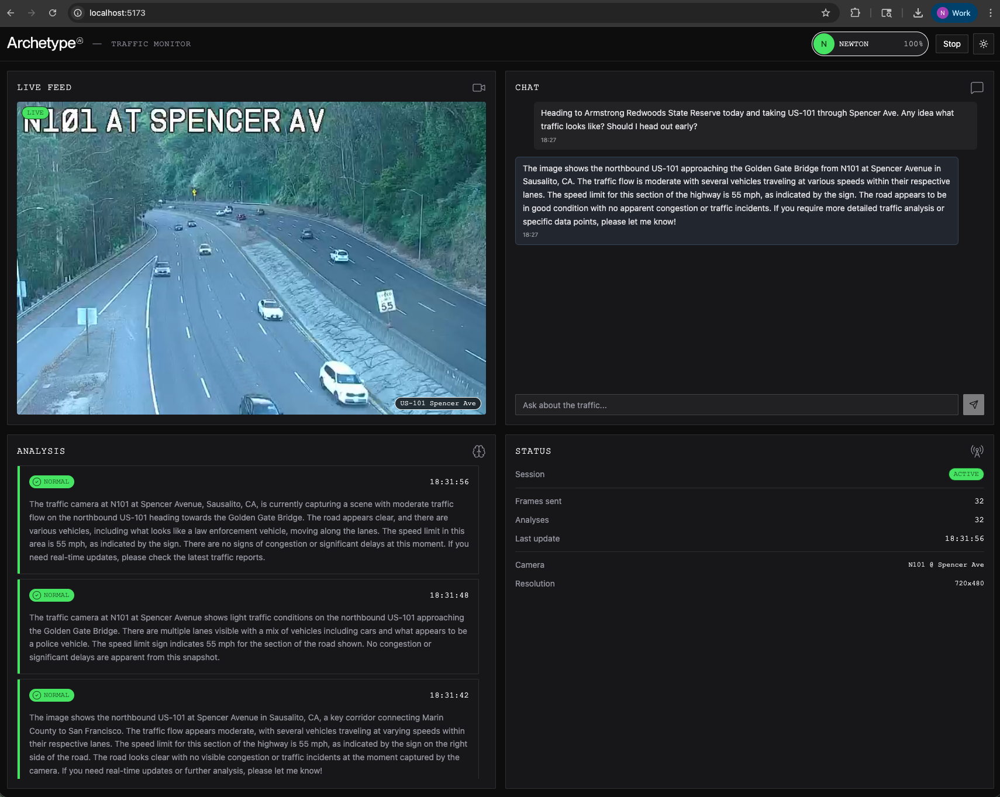

# Newton Traffic Demo

Real-time traffic monitoring dashboard powered by [Newton](https://www.archetypeai.dev/) and a live Caltrans CCTV feed.

Analyzes the **US-101 at Spencer Avenue** camera (Sausalito, CA — Golden Gate Bridge approach) using Newton's vision model, with an interactive chat for asking questions about current traffic conditions.



## Features

- **Live HLS stream** from Caltrans CCTV (720x480, US-101 northbound)
- **Automatic analysis** — Newton analyzes frames every 8 seconds, reporting on traffic flow, vehicle density, incidents, and visibility
- **Interactive chat** — ask Newton questions about what it sees on the camera
- **Analysis history** — scrolling log of observations with severity-coded labels (Normal, Congestion, Incident)
- **Session status** — frame count, analysis count, last update time

## Stack

- **SvelteKit** with Svelte 5 runes
- **Archetype AI Design System** — semantic tokens, component primitives, composite patterns
- **Newton API** — vision model via lens/session API (`model.query` with base64 JPEG frames)
- **hls.js** — HLS stream playback in the browser
- **Tailwind v4** — styling with semantic design tokens

## Setup

```bash
npm install
```

Create a `.env` file:

```
ATAI_API_KEY=your_api_key_here
ATAI_API_ENDPOINT=https://api.u1.archetypeai.app/
```

## Development

```bash
npm run dev
```

Open `http://localhost:5173`, then click **Start Analysis** to begin.

## Architecture

```
src/
├── routes/
│   ├── +page.svelte              # Dashboard orchestrator
│   └── api/
│       ├── session/+server.js    # Newton lens/session lifecycle
│       └── analyze/+server.js    # Frame analysis endpoint
├── lib/
│   ├── server/newton.js          # Server-side Newton API client
│   ├── api/newton.js             # Client-side fetch wrappers
│   └── components/ui/
│       ├── primitives/           # DS registry primitives
│       ├── patterns/             # DS registry patterns
│       └── custom/               # Project-specific components
│           ├── traffic-feed.svelte    # HLS player + status overlay
│           ├── chat-panel.svelte      # Interactive Q&A with Newton
│           ├── analysis-log.svelte    # Scrolling analysis history
│           └── traffic-status.svelte  # Session & camera info
```

## How It Works

1. **Start Analysis** creates a Newton lens session (registers lens, creates session, initializes processor)
2. The HLS stream plays via hls.js in a `<video>` element
3. Every 8 seconds, a frame is captured from the video via canvas, encoded as base64 JPEG, and sent to Newton's `model.query` endpoint
4. Newton returns a traffic analysis which is displayed in the Analysis panel with auto-inferred severity
5. Users can ask questions in the Chat panel — each question captures the current frame and sends it with the custom query to Newton
